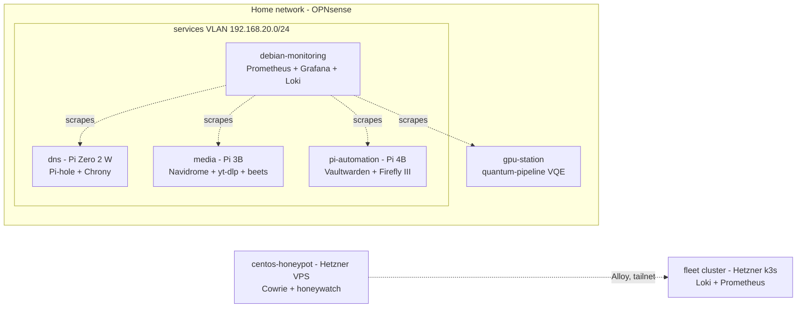

<!-- markdownlint-disable MD033 MD041 -->
<h1 align="center">cloud</h1>

<div align="center">

[Codeberg](https://codeberg.org/piotrkrzysztof/cloud) &middot;
[GitHub mirror](https://github.com/straightchlorine/cloud) &middot;
[fleet](https://codeberg.org/piotrkrzysztof/fleet)

[](https://ci.codextechnologies.org/repos/2)
[](https://docs.ansible.com/)
[](https://ansible.readthedocs.io/projects/molecule/)

Ansible definitions for the homelab: <br/>
Raspberry Pi service hosts, a monitoring VM, a GPU box and an internet-facing SSH honeypot.

</div>

## Architecture



Every host is in `inventory/production/hosts.yml`. `playbooks/site.yml` brings up
the whole fleet; each stack also has its own play, and a teardown play where it
can be removed cleanly.

The Pi hosts sit on the services VLAN behind OPNsense. Their stacks publish plain
HTTP on the LAN; TLS terminates at a central reverse proxy that is not managed here.

The honeypot is a VPS that Ansible reaches over the Headscale tailnet only, and
its logs and metrics travel the same way.

The Kubernetes side - the Hetzner and OCI clusters, the Talos node - lives in
[fleet](https://codeberg.org/piotrkrzysztof/fleet).

## What it does

- Runs Pi-hole and a Chrony NTP server on a Pi 3B (planned Pi Zero 2 W)
- Runs a music pipeline on a Pi 3B: yt-dlp playlist downloads, beets tagging
  against MusicBrainz, Navidrome streaming and an interactive library review
- Runs Vaultwarden and Firefly III with MariaDB on a Pi 4B, kept current by Watchtower
- Runs Prometheus, Grafana, Loki and Alertmanager on a Debian VM, scraping node,
  Docker, Pi-hole and NVIDIA exporters
- Prepares a GPU host for [quantum-pipeline](https://github.com/straightchlorine/quantum-pipeline)
  benchmark runs, and holds the kernel and NVIDIA stack while one is pending
- Hardens the CentOS Stream 10 VPS behind
  [honeywatch](https://github.com/straightchlorine/honeywatch): tailnet-only admin
  SSH, SELinux, firewalld, unattended updates

## Quick start

Prerequisites: Python 3, [just](https://github.com/casey/just), Podman for the
tests, and the vault password.

```bash
just setup                    # venv, dependencies, collections, git hooks
just lint                     # ansible-lint + yamllint
just syntax                   # syntax-check every playbook
just test                     # molecule for every role; just test media [scenario]
just deploy                   # playbooks/site.yml - the whole fleet
just deploy-service media     # playbooks/media.yml, asks first
```

Or straight to Ansible, limited to one host and one stack:

```bash
ansible-playbook -i inventory/production/hosts.yml playbooks/site.yml \
  --limit media --tags media --ask-vault-pass
```

The honeypot has its own play, `playbooks/honeypot.yml`, run from a machine on the
tailnet. Teardowns are plays as well:
`playbooks/{dns,media,automation,gpu-qp,honeybench}-teardown.yml`.

## Roles

| Role | What it is |
|---|---|
| `common` | The base every host gets: packages, Docker, network facts, backups, ntfy, Syncthing, board tuning |
| `os` | Normalises OS and CPU facts (`os_*`), so roles validate instead of assuming |
| `hardware` | Resource limits for every container, from the host's `device_type` |
| `firewall` | UFW rules |
| `dns` | Pi-hole + Chrony NTP |
| `media` | Navidrome + yt-dlp + beets pipeline |
| `automation` | Vaultwarden + Firefly III + MariaDB + Watchtower |
| `monitoring` | Prometheus + Grafana + Loki + Alertmanager |
| `prometheus-exporters` | Node, Docker, Pi-hole and NVIDIA exporters |
| `gpu-qp` | GPU host for quantum-pipeline: driver, container toolkit, benchmark tooling |
| `honeypot` | The honeywatch VPS: sshd, firewalld, SELinux, updates, image pruning |
| `alloy` | Grafana Alloy: the journal and host metrics to the fleet cluster over the tailnet |
| `honeybench` | CentOS Stream 10 VM for benchmarking honeywatch |
| `backup`, `backup-system` | Restic backups; due for a rework |

`roles/dns` is the reference role: structure, fail-fast validation, post-deploy
checks, teardown and Molecule scenarios. Where an older role does it differently,
`dns` wins.

## Hosts and groups

| Group | Hosts | Drives |
|---|---|---|
| `services` | `dns`, `media`, `pi-test-media`, `pi-automation` | the stack plays and the exporter fleet |
| `music` | `media`, `pi-test-media` | the media play; `pi-test-media` is disposable staging |
| `monitoring` | `debian-monitoring` | the monitoring play |
| `prometheus` | `services`, `backup_primary`, `workstations`, `gpu_qp` | Node Exporter and scrape targets |
| `gpu_qp` | `gpu-station` | the GPU host play |
| `workstations` | `station-arch` | monitoring |
| `honeypot` | `centos-honeypot` | `playbooks/honeypot.yml`; outside every `all` play (CentOS, no apt or ufw) |
| `bench` | `honeybench` | `playbooks/honeybench.yml`; outside every `all` play |

## Configuration

Secrets live in `inventory/production/group_vars/all/vault.yml`, which is
gitignored; start from
[vault.yml.example](inventory/production/group_vars/vault.yml.example). Every
deploy needs `--ask-vault-pass`. Per-host settings go in
`inventory/production/host_vars/<host>.yml`.

Required variables have no defaults. A missing one fails the pre-deploy
validation instead of deploying something half-configured.

## Testing

Every role validates before it deploys - required variables, vault placeholders,
interfaces, OS and architecture - and checks the service afterwards instead of
assuming it came up.

Molecule runs each role under Podman: a `default` scenario that converges the
real tasks, a `fail-fast-validation` scenario per failure case, and a `teardown`
scenario where the role has one. For what a container cannot prove,
`scripts/<role>/validate-deploy.sh` checks a real host from outside and
`validate-clean.sh` confirms a teardown left nothing behind.

CI is Woodpecker on Codeberg. `.woodpecker/lint.yaml` runs the linters on every
push; `.woodpecker/test.yaml` runs Molecule for `dns`, `automation`, `media`,
`honeypot` and `gpu-qp`. A role joins that matrix once its tests converge the real
role rather than fixtures.

## Documentation

There is no docs site. Each role's `README.md` covers its variables, deploy steps
and recovery runbook, and `CLAUDE.md` holds the standards every role follows.
`docs/` is the author's working notes and is not published.

---

<div align="center">

To the only God, be honour and glory for ever and ever.

</div>
